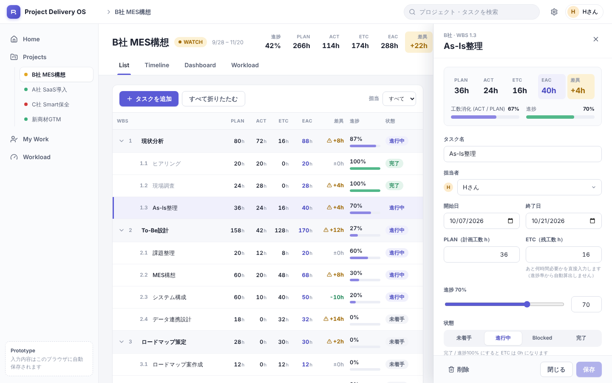
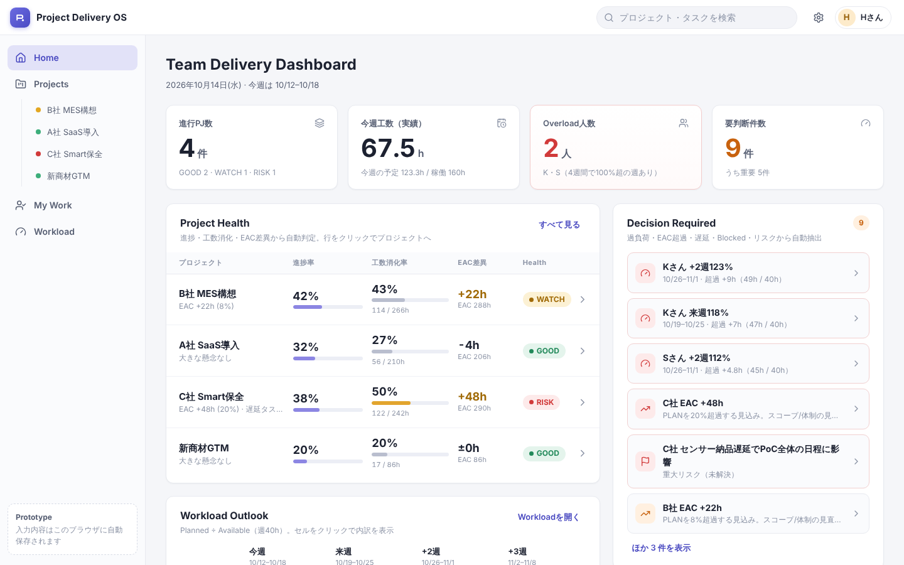
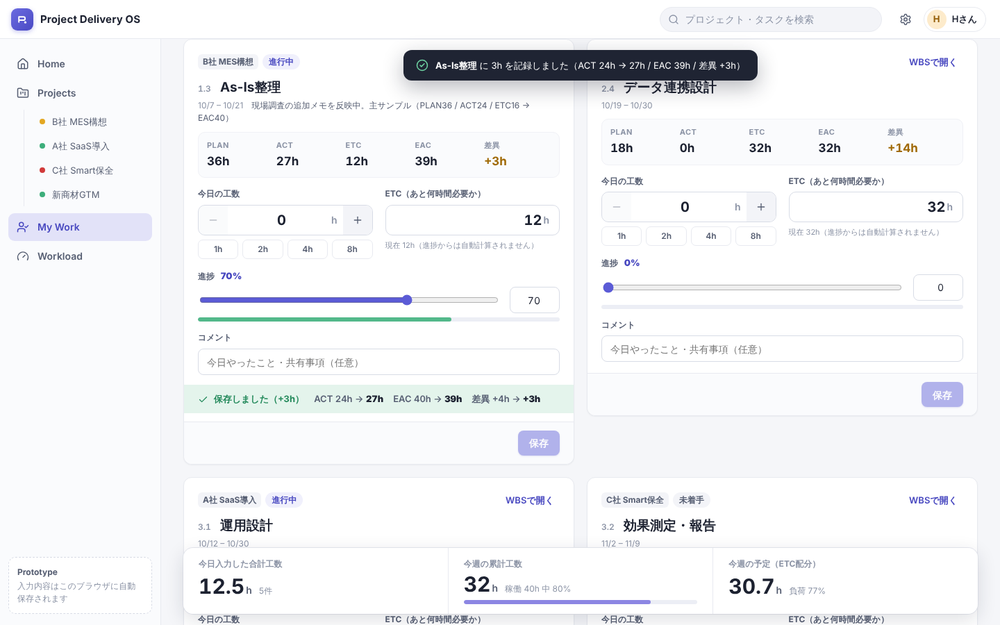
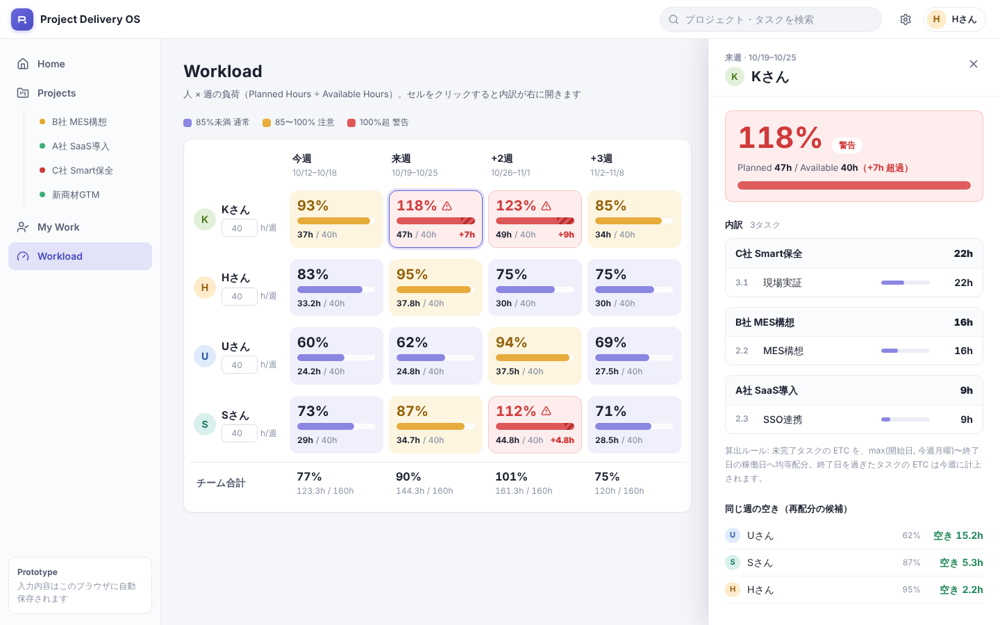
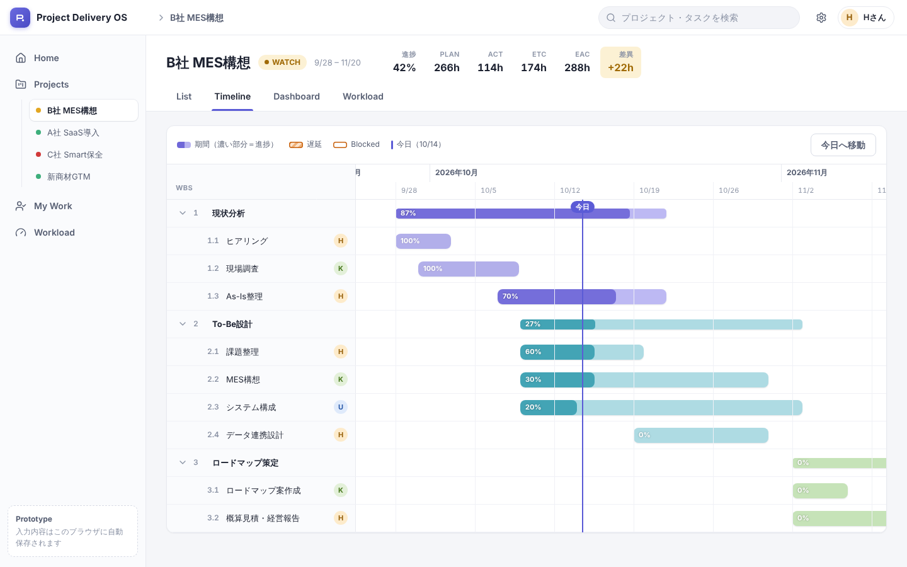
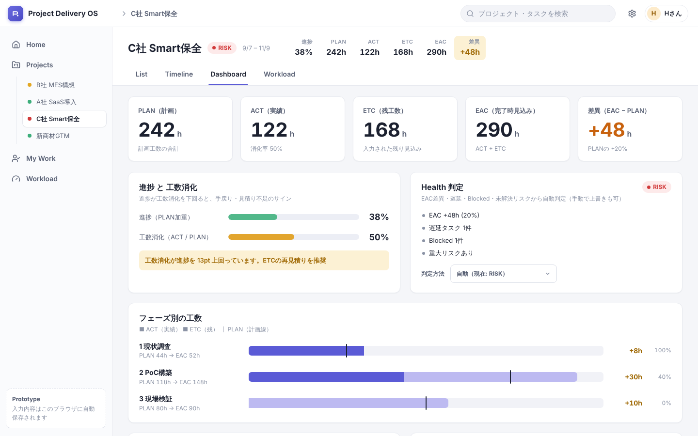

# Project Delivery OS（UIプロトタイプ）

PJ・WBS・工数・人員負荷を **ひとつの数字の流れ** でつなぐ、プロジェクト管理 UI のローカルプロトタイプです。
本番（Google Apps Script / Google Sheets）に入る前に、**WBS の見え方・工数入力の操作性・Workload・Dashboard・Timeline** を実際に触って確認するためのものです。

```
WBS → 計画工数(PLAN) → 実績工数(ACT) → 残工数(ETC) → EAC → 人員負荷(Workload) → マネジメント判断(Dashboard)
```

見た目だけの静的モックではなく、**入力した内容が全画面に即時反映**されます。

| WBS（List）+ 右ドロワー | Dashboard |
| --- | --- |
|  |  |
| **My Work（工数入力）** | **Workload + セル内訳** |
|  |  |
| **Timeline** | **プロジェクト Dashboard タブ** |
|  |  |

## 技術構成

| 項目 | 内容 |
| --- | --- |
| Framework | React 18 + TypeScript |
| Build | Vite 6 |
| Routing | react-router-dom 7 |
| Styling | 素の CSS（`src/styles/*.css`。デザイントークンは `tokens.css`） |
| Icons / Date | lucide-react / date-fns |
| State | React Context + `useReducer`（Redux 等は不使用） |
| 保存 | `localStorage`（バックエンド・DB・認証・外部APIなし） |
| Test | Vitest（工数計算・Workload・Health のロジックテスト） |

## インストール

Node.js **22.12 以上**を推奨します（アプリの起動・ビルドは Node 20 以上で動作。`npm test`（Vitest 5）のみ 22.12 以上が必要）。

```bash
npm install
```

## 起動

```bash
npm run dev        # http://localhost:5173 で起動（初期表示は Dashboard）
```

その他のコマンド:

```bash
npm run build      # 型チェック(tsc) + 本番ビルド
npm run preview    # ビルド結果の確認
npm run typecheck  # TypeScript チェックのみ
npm run lint       # ESLint
npm test           # ロジックのユニットテスト
```

## 主要画面

| 画面 | Route | 内容 |
| --- | --- | --- |
| Dashboard | `/` | KPI 4枚 / Project Health / Workload Outlook / Decision Required / Recent Wins |
| Projects | `/projects` | プロジェクト一覧（Health 付き） |
| Project: List | `/projects/:id` | **WBS 一覧**。階層・折りたたみ・親の自動集計・右ドロワーで編集・Add Task |
| Project: Timeline | `/projects/:id/timeline` | 同じ WBS を週単位の日付軸で表示。今日線・遅延/Blocked の区別 |
| Project: Dashboard | `/projects/:id/dashboard` | PJ 単位の工数サマリー・フェーズ別 PLAN/ACT/EAC・Health 根拠・リスク |
| Project: Workload | `/projects/:id/workload` | このPJの担当者の、全PJ合算の負荷（本PJ分を併記） |
| My Work | `/my-work` | 担当タスクのカードに **今日の工数 / ETC / 進捗 / コメント** を入力して保存 |
| Workload | `/workload` | 人 × 週（今週〜+3週）の負荷率。セルクリックで内訳ドロワー |

共通: 左サイドバー（Home / Projects / My Work / Workload）、上部バー（検索・設定・ユーザー）。
タスクのドロワーは URL（`?task=<id>`）で開閉するので、List / Timeline / Dashboard の判断カードなど、どこからでも同じドロワーが開きます。

### 触って確認できる主なループ

1. **工数入力 → 全画面**
   My Work で `As-Is整理` に **3h** と **ETC 12h** を入力して保存
   → ACT 24h→27h、EAC 40h→39h、差異 +4h→+3h
   → WBS の親行・ヘッダー・Dashboard の「EAC差異」「今週工数」・Workload の負荷が更新
2. **WBS 編集 → Workload / Dashboard**
   WBS のドロワーで担当者・日付・ETC を変更 → Workload の負荷率と「Decision Required」が変化
   （例: C社 `現場実証` の担当を K → U にすると、K の来週 118% が下がり、U が過負荷になる）
3. **日付変更 → Timeline**
   List 側の開始/終了日の変更が Timeline のバー位置に反映
4. **完了処理**
   進捗 100% / 状態「完了」にすると ETC は 0h になり、その分が Workload から外れる

## 工数・指標の定義

| 値 | 定義 |
| --- | --- |
| PLAN | 計画工数（ユーザー入力） |
| ACT | `TimeEntry.hours` を `wbsId` ごとに合計した実績 |
| ETC | 完了までに必要な残工数。**ユーザーが「あと何時間必要か」を直接入力**する独立値（進捗率からは自動算出しない） |
| EAC | `ACT + ETC` |
| Variance（差異） | `EAC - PLAN`（+ は超過見込み） |
| Effort Burn（工数消化率） | `ACT / PLAN` |
| 親行 | PLAN / ACT / ETC / EAC は子の合計、進捗は最下位タスクの PLAN 加重平均 |
| PJ 進捗 / PJ EAC | 最下位タスクの PLAN 加重進捗 / 全最下位タスクの EAC 合計 |

実装は `src/domain/calculations.ts`（テスト: `calculations.test.ts`）。

### My Work の保存時の挙動

`保存` = **TimeEntry を 1 件追加**（今日の工数 > 0 またはコメントあり）＋ **WBS の ETC・進捗を更新**。
進捗が 100% なら状態を「完了」にして ETC を 0 に、未着手に工数/進捗が入ったら「進行中」にします（`resolveLogWork`）。
誤入力は My Work 下部の「今日の入力履歴」の ✕ で取り消せます（ACT も戻ります）。

### Workload の算出ルール（プロトタイプ用の素朴な近似）

- Available = 各人の週あたり稼働（初期値 40h。Workload 画面で編集可）
- Planned = **未完了タスクの ETC** を `max(開始日, 今週の月曜)` 〜 終了日の **稼働日（平日）へ均等配分**し、週ごとに合算
  - 終了日を過ぎたタスク（遅延）の ETC は **今週にすべて計上**
  - 今週〜+3週の外にはみ出す分は表示に含めない
- Utilization = Planned / Available
- 色分け: 85% 未満＝通常（紫）／85〜100%＝注意（黄）／**100% 超＝警告（赤）**

実装は `src/domain/workload.ts`。

### Health の自動判定（プロトタイプ用ルール）

| 判定 | 条件 |
| --- | --- |
| RISK | EAC が PLAN を **15% 以上**超過、または **遅延とBlockedが同時**にある |
| WATCH | EAC 超過 5% 以上 / 遅延あり / Blocked あり / 未解決の高リスクあり |
| GOOD | 上記以外 |

プロジェクトの Dashboard タブで `手動: GOOD / WATCH / RISK` に上書きもできます。
「Decision Required」は 過負荷(100%超)・EAC超過・遅延・Blocked・未解決リスク から**毎回導出**されます（`src/domain/decisions.ts`）。

## 初期ダミーデータ

| PJ | 状態 | 特徴 |
| --- | --- | --- |
| B社 MES構想 | WATCH | EAC超過見込み。WBS 3フェーズ。**主サンプル**（`As-Is整理` = PLAN 36h / ACT 24h / ETC 16h → EAC 40h / 差異 +4h） |
| A社 SaaS導入 | GOOD | 進捗が工数消化より先行 |
| C社 Smart保全 | RISK | 遅延・EAC超過・Blocked |
| 新商材GTM | GOOD | 小規模 |

ユーザーは K / H / U / S の4名（初期の My Work ユーザーは H）。
Workload は 60〜120% 超まで散らばるよう調整済みです（例: K = 93 / 118 / 123 / 85%）。

> **日付について**: seed の日付は「起動した週の月曜」基準で生成されます（常に今週〜+3週に負荷が乗り、遅延/Blocked が見えるように）。
> 曜日に依存せず同じ Health になることをテストで確認しています。
> URL に `?today=2026-10-14` を付けると「今日」を固定して確認できます（デモ・動作確認用）。

## データ保存方法

- 変更は **即座に `localStorage`**（キー: `project-delivery-os:v1`）へ保存されます。
  対象: WBS 変更 / PLAN / ETC / 進捗 / 日付 / 担当者 / TimeEntry / 新規・削除タスク / Health 上書き / 稼働時間 など。
- リロードしても状態は維持されます。別タブでの変更も `storage` イベントで同期します。
- データ構造を変えた場合はキーのバージョン（`v1`）を上げると、古い保存データを破棄して seed から再開します。
- ブラウザの開発者ツール → Application → Local Storage で中身を確認・削除できます。
- seed を作った週と違う週に開くと、Dashboard 上部に「今週に合わせて初期化」の案内が出ます。

## Reset Demo Data（デモデータの初期化）

右上の **⚙ 設定 → 「デモデータを初期化」**（確認ダイアログあり）。
`localStorage` を消去して seed データへ戻し、基準日も今週に更新します。

## ディレクトリ構成

```
src/
  domain/          画面に依存しない純粋なロジック（← GAS 移植時もそのまま使える）
    types.ts         User / Project / WbsItem / TimeEntry / Risk
    calculations.ts  ACT・ETC・EAC・Variance・親集計・Health・工数入力の解決
    workload.ts      週バケット・ETC の均等配分・負荷率
    decisions.ts     Decision Required の導出
    dates.ts / format.ts
    calculations.test.ts
  data/seed.ts     初期ダミーデータ（週基準で生成）
  store/
    AppContext.tsx   状態 + アクション + 導出データの提供
    reducer.ts       状態遷移（WBS更新 / LOG_WORK など）
    derived.ts       state → 全画面共通の集計（metrics / workload / decisions …）
    persistence.ts   localStorage の読み書き（← 本番では差し替え）
  components/      AppShell / Sidebar / Topbar / ProjectHeader / WbsTable / TaskDrawer /
                   TimelineView / WorkloadGrid / WorkloadDrawer / WorkCard / KpiCard / Drawer ほか
  pages/           DashboardPage / ProjectsPage / ProjectPage / MyWorkPage / WorkloadPage
  hooks/useTaskParam.ts  ドロワーの開閉を URL に持たせる
  styles/          tokens / shell / ui / drawer / wbs / workload / timeline / dashboard / mywork
```

4つの主要画面はすべて `store/derived.ts` の **同一の導出データ**を参照します。入力が変わると同じ元データから再計算されるため、画面間で数字がずれません。

## 将来 GAS（Google Apps Script + Google Sheets）へ移植する際のポイント

**そのまま持っていけるもの**

- `src/domain/*` は DOM にも React にも依存しない純粋な TypeScript です。
  GAS 側（clasp + TypeScript）にも、HTML Service のクライアント側にも同じ計算ロジックを流用できます。
  計算を「サーバー（GAS）で行う / クライアントで行う」のどちらにしても結果が一致するよう、テストを残してあります。
- UI（`components/` `pages/` `styles/`）は、Vite でビルドした成果物を GAS の **HTML Service** に載せる想定です
  （単一HTML化: `vite-plugin-singlefile` などでインライン化）。

**差し替えるもの**

| 現在（プロトタイプ） | 本番（GAS + Sheets） |
| --- | --- |
| `store/persistence.ts`（`localStorage`） | `google.script.run` 経由で Sheets を読み書きするクライアント。`loadData` / `saveData` を非同期 API に置き換え |
| `store/AppContext.tsx` の `init()` と各アクション | 起動時に一括ロード（`getAppData`）、更新は差分保存（`saveWbs` / `appendTimeEntry` …）。楽観的更新 + 失敗時ロールバック |
| `data/seed.ts` | 初期データ投入用の `setupSheets()`（シート作成・ヘッダー・サンプル行） |
| `AppData.currentUserId` | `Session.getActiveUser().getEmail()` と Users シートの突合（権限もここで） |
| `BrowserRouter` | GAS の iframe では履歴 API が使えないため `HashRouter` かステートでの画面切替 |
| `storage` イベントによる他タブ同期 | 一定間隔のポーリング、または更新時の再取得 |
| `?today=` | 不要（削除可） |

**シート設計の目安**（型 = 1シート、1行 = 1レコード。日付は ISO 文字列 `yyyy-MM-dd`）

| シート | 列 |
| --- | --- |
| `Users` | id, name, initials, weeklyCapacity |
| `Projects` | id, name, status, startDate, endDate, health |
| `WBS` | id, projectId, parentId, title, ownerId, startDate, endDate, planHours, etcHours, progress, status, comment |
| `TimeEntries` | id, wbsId, userId, date, hours, comment（**追記専用**にすると ACT の監査性が高い） |
| `Risks` | id, projectId, wbsId, severity, title, status |

**設計上の注意**

- ACT は `TimeEntries` の集計で導出し、WBS シートに保存しない（二重管理を避ける）。
- 同時編集は `LockService` で保護し、`updatedAt` / 版番号での競合検知を検討。
- `google.script.run` は遅いので、「起動時に一括取得 → 画面ではメモリ上のデータで計算 → 保存は debounce」にする。
- 親行の集計・Workload・Health は保存せず、毎回導出する現在の方針のまま移植する。

## 仮定と未実装（プロトタイプの範囲）

- 実装しない: GAS / Google Sheets 連携、認証・権限、メール通知、外部API、依存関係のドラッグ編集、会計・原価計算、AI機能。
- Timeline はバーのドラッグ編集なし（日付は List のドロワーで変更）。表示は日単位の幅で、週ヘッダー付き。
- Workload は週次のみ。ETC の配分は均等配分の近似（週別に手入力は不可）。
- WBS の並び順は配列順（ドラッグ並べ替えなし）。階層は「フェーズ → タスク」を想定（子は何階層でも集計されるが、追加 UI は最上位/フェーズ直下）。
- 祝日・個人の休暇は考慮しない（平日 = 稼働日）。
- 検索はプロジェクト名・タスク名の部分一致のみ。
