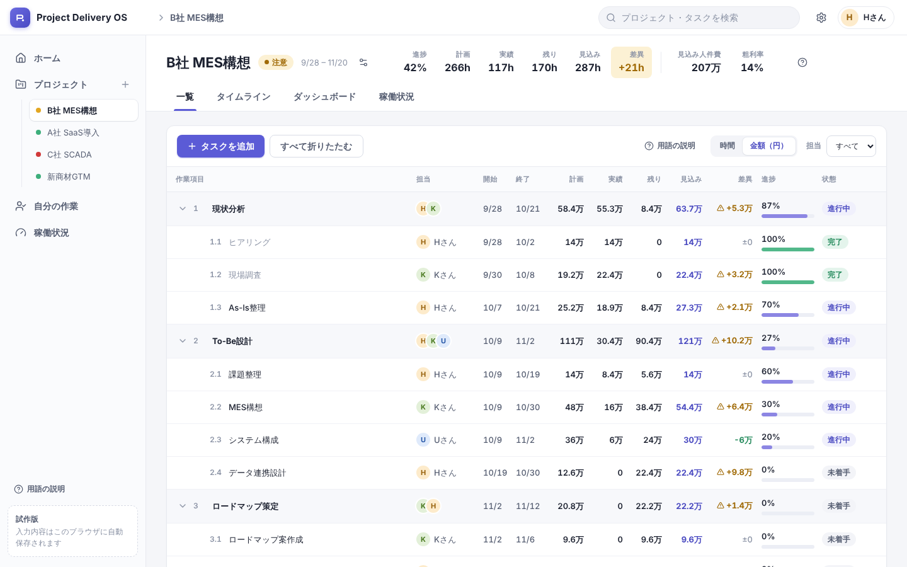
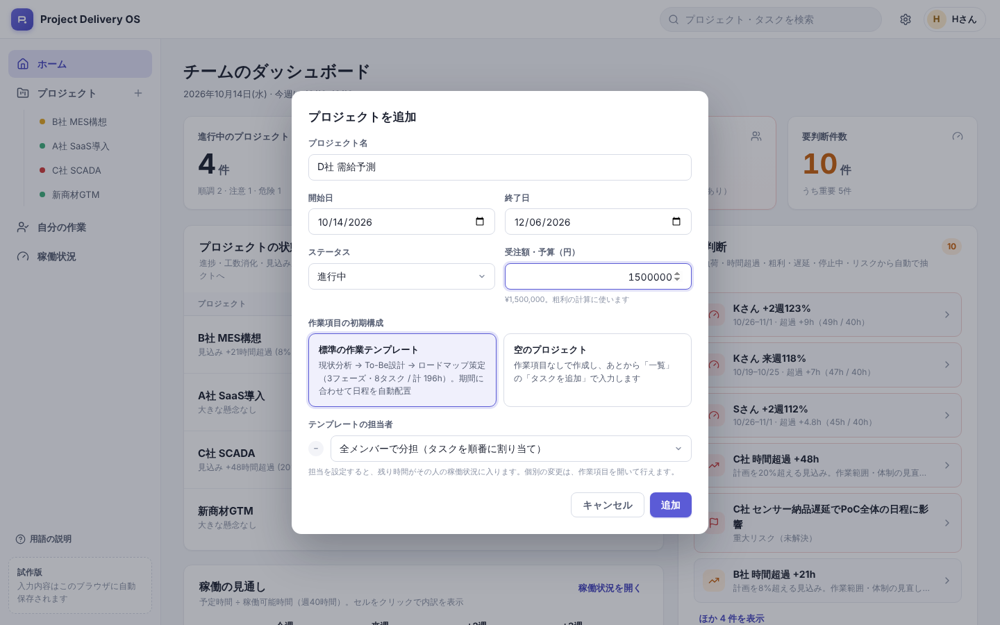
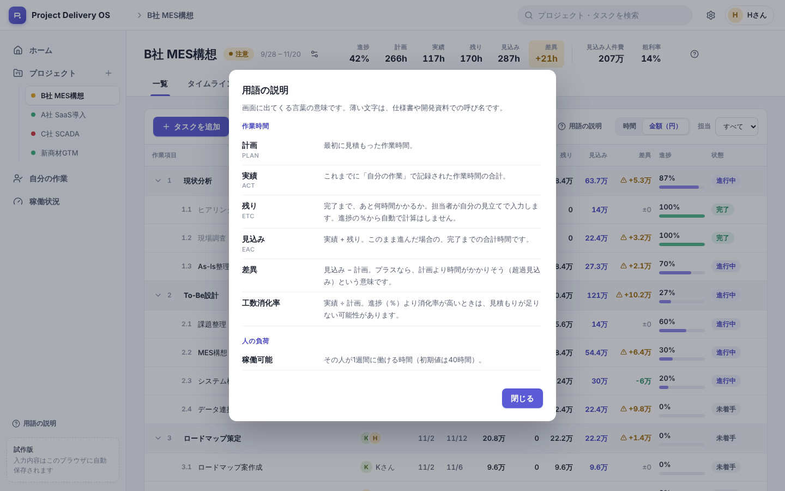

# Project Delivery OS（UIプロトタイプ）

プロジェクトの作業・作業時間・人の負荷・お金を **ひとつの数字の流れ** でつなぐ、プロジェクト管理 UI のローカルプロトタイプです。
本番（Google Apps Script / Google Sheets）に入る前に、**作業一覧の見え方・作業時間の入力しやすさ・稼働状況・ダッシュボード・タイムライン** を実際に触って確認するためのものです。

```
作業項目 → 計画 → 実績 → 残り → 見込み → 人の負荷(稼働状況) → マネジメント判断(ダッシュボード)
```

> 画面の言葉はすべて日本語です。仕様書（PLAN / ACT / ETC / EAC など）との対応は、下の「[画面の用語と仕様書の対応](#画面の用語と仕様書の対応)」と、画面左下の「用語の説明」を見てください。

見た目だけの静的モックではなく、**入力した内容が全画面に即時反映**されます。

| 作業一覧 + 右ドロワー | ダッシュボード |
| --- | --- |
|  |  |
| **自分の作業（時間の入力）** | **稼働状況 + セルの内訳** |
|  |  |
| **タイムライン** | **プロジェクトのダッシュボード** |
|  |  |
| **作業一覧（金額表示）** | **プロジェクトの追加** |
|  |  |
| **用語の説明** | |
|  | |

## 技術構成

| 項目 | 内容 |
| --- | --- |
| Framework | React 18 + TypeScript |
| Build | Vite 6 |
| Routing | react-router-dom 7 |
| Styling | 素の CSS（`src/styles/*.css`。デザイントークンは `tokens.css`） |
| Icons / Date | lucide-react / date-fns |
| State | React Context + `useReducer`（Redux 等は不使用） |
| 保存 | `localStorage`（バックエンド・DB・認証・外部APIなし） |
| Test | Vitest（作業時間・人件費・稼働・状態判定のロジックテスト） |

## インストール

Node.js **22.12 以上**を推奨します（アプリの起動・ビルドは Node 20 以上で動作。`npm test`（Vitest 5）のみ 22.12 以上が必要）。

```bash
npm install
```

## 起動

```bash
npm run dev        # http://localhost:5173 で起動（初期表示はダッシュボード）
```

その他のコマンド:

```bash
npm run build      # 型チェック(tsc) + 本番ビルド
npm run preview    # ビルド結果の確認
npm run build:single  # JS/CSS 込みの単一HTML（dist-single/index.html）を出力。ダブルクリックで開ける
npm run typecheck  # TypeScript チェックのみ
npm run lint       # ESLint
npm test           # ロジックのユニットテスト
```

> **単一HTML版について**: `npm run build:single` の成果物は URL に依存しないメモリルーターで動き、そのまま開けます。
> チャットや iframe のプレビュー等で `localStorage` が使えない環境では、画面上部に「保存されない」旨のバナーが出て、入力はページを閉じるまでの一時的なものになります。

## 画面の用語と仕様書の対応

| 画面での名前 | 仕様書・開発での名前 | 意味 |
| --- | --- | --- |
| 計画 | PLAN | 最初に見積もった作業時間 |
| 実績 | ACT | これまでに記録された作業時間の合計（`TimeEntry` の合計） |
| 残り | ETC | 完了まで、あと何時間かかるか（担当者が直接入力。進捗の％からは自動計算しない） |
| 見込み | EAC | 実績 + 残り（このまま進んだ場合の合計時間） |
| 差異 | Variance | 見込み − 計画（＋は計画より時間がかかる） |
| 工数消化率 | Effort Burn | 実績 ÷ 計画 |
| 稼働可能 / 予定 / 負荷率 | Available / Planned / Utilization | その人の1週間の稼働時間 / 割り振られた作業時間 / 予定 ÷ 稼働可能 |
| 順調 / 注意 / 危険 | GOOD / WATCH / RISK | プロジェクトの状態 |
| 停止中 | Blocked | 何かの待ちで進められない作業 |
| 作業項目 | WBS | 作業をフェーズ → タスクに分けた一覧 |
| 作業時間の記録 | TimeEntry | 「自分の作業」で入力した1件ごとの時間 |
| ホーム / プロジェクト / 自分の作業 / 稼働状況 | Home / Projects / My Work / Workload | 左メニュー |
| 一覧 / タイムライン / ダッシュボード / 稼働状況 | List / Timeline / Dashboard / Workload | プロジェクト画面のタブ |
| 要判断 / 最近の成果 | Decision Required / Recent Wins | ダッシュボードのカード |

時間の単位 `h` は「時間」の記号です（36h ＝ 36時間）。画面左下の「**用語の説明**」からも確認できます。

## 主要画面

| 画面 | Route | 内容 |
| --- | --- | --- |
| ダッシュボード | `/` | 数字4枚 / プロジェクトの状態 / 稼働の見通し / 要判断 / 最近の成果 |
| プロジェクト | `/projects` | プロジェクト一覧（状態つき）。**「プロジェクトを追加」**ボタン |
| プロジェクト: 一覧 | `/projects/:id` | **作業一覧（WBS）**。階層・折りたたみ・親の自動集計・右ドロワーで編集・タスクを追加 |
| プロジェクト: タイムライン | `/projects/:id/timeline` | 同じ作業を週単位の日付軸で表示。今日線・遅延/停止中の区別 |
| プロジェクト: ダッシュボード | `/projects/:id/dashboard` | プロジェクトの時間のまとめ・**人件費と粗利**・メンバー別の人件費・フェーズ別の計画/実績/見込み・状態の根拠・リスク |
| プロジェクト: 稼働状況 | `/projects/:id/workload` | このプロジェクトの担当者の、全プロジェクト合算の負荷（このプロジェクト分を併記） |
| 自分の作業 | `/my-work` | 担当タスクのカードに **今日の時間 / 残り / 進捗 / コメント** を入力して保存 |
| 稼働状況 | `/workload` | 人 × 週（今週〜+3週）の負荷率。セルクリックで内訳ドロワー |

共通: 左サイドバー（ホーム / プロジェクト / 自分の作業 / 稼働状況）、上部バー（検索・設定・ユーザー）。
タスクのドロワーは URL（`?task=<id>`）で開閉するので、一覧・タイムライン・ダッシュボードの判断カードなど、どこからでも同じドロワーが開きます。

## プロジェクトを追加・編集・削除する

- **追加**: 左サイドバー「プロジェクト」横の **＋**、プロジェクト画面の「プロジェクトを追加」、ダッシュボードの「＋ プロジェクトを追加」のどれからでも。
  - 入力: プロジェクト名 / 開始日・終了日 / ステータス / 受注額・予算（任意）/ 作業項目の初期構成
  - **標準の作業テンプレート**: 現状分析 → To-Be設計 → ロードマップ策定（3フェーズ・8タスク・計196h）。期間の営業日に、計画時間の比率で日程を自動配置します。担当者は「全メンバーで分担（順番に割り当て）」「特定の1人」「未設定」から選べます（残りの初期値 ＝ 計画）。開始日の初期値は「今日以降の最初の営業日」です。
  - **空のプロジェクト**: 作成後に「一覧」の「タスクを追加」で作業項目を作ります。
- **編集・削除**: プロジェクト画面ヘッダーの **⚙（プロジェクト設定）**で、名称・期間・ステータス・受注額の変更とプロジェクトの削除（配下の作業項目・作業時間の記録・リスクも削除）。

### 触って確認できる主なループ

1. **作業時間の入力 → 全画面**
   「自分の作業」で `As-Is整理` に **3h** と **残り 12h** を入力して保存
   → 実績 24h→27h、見込み 40h→39h、差異 +4h→+3h
   → 作業一覧の親行・ヘッダー・ダッシュボードの「見込み差異」「今週工数」・稼働状況の負荷が更新
2. **作業項目の編集 → 稼働状況 / ダッシュボード**
   作業項目のドロワーで担当者・日付・残りを変更 → 稼働状況の負荷率と「要判断」が変化
   （例: C社 `現場実証` の担当を K → U にすると、K の来週 118% が下がり、U が過負荷になる）
3. **日付変更 → タイムライン**
   「一覧」側の開始/終了日の変更が、タイムラインのバー位置に反映
4. **完了処理**
   進捗 100% / 状態「完了」にすると、残りは 0h になり、その分が稼働状況から外れる

## 人件費と粗利

作業時間に単価を掛けた**人件費**を、作業時間と同じ流れで計算します。

| 画面での名前 | 計算 |
| --- | --- |
| 時間単価 | メンバーごとの円/時間（初期: K 8,000 / H 7,000 / U 6,000 / S 5,000）。右上の **⚙ → 「メンバーと単価」** で変更。人日単価（×8h）も併記 |
| 計画の人件費 | 計画 × **担当者**の単価 |
| 実績の人件費 | Σ（実績 × **入力した人**の単価） |
| 残りの人件費 | 残り × **担当者**の単価 |
| 見込みの人件費 | 実績の人件費 + 残りの人件費 |
| 人件費の差異 | 見込みの人件費 − 計画の人件費 |
| 見込み粗利 / 粗利率 | 受注額 − 見込みの人件費 / 見込み粗利 ÷ 受注額（受注額が未設定のプロジェクトは計算しない） |

- 担当者が未設定のタスクは、全メンバーの平均単価で計算します。
- **作業一覧**は右上の「時間 / 金額（円）」で数値列を切り替えられます（金額は万円表記）。タスクのドロワーでも、計画・残り・担当を変えると人件費がその場で再計算されます。
- **プロジェクトのダッシュボード**に、受注額・人件費・粗利の内訳バーと、メンバー別の人件費（人日換算つき）があります。ヘッダーにも「見込み人件費」「粗利率」を表示します。
- 粗利率が目安の **10%** を下回ると、ダッシュボードの「要判断」に出ます（赤字は重要扱い）。
- 実績の単価は「現在の単価」で再計算されます（単価の履歴は持ちません）。実装は `src/domain/calculations.ts`。

## 作業時間・指標の定義

| 画面での名前（仕様書での名前） | 定義 |
| --- | --- |
| 計画（PLAN） | 見積もった作業時間（ユーザー入力） |
| 実績（ACT） | `TimeEntry.hours` を `wbsId` ごとに合計したもの |
| 残り（ETC） | 完了までに必要な残り時間。**ユーザーが「あと何時間かかるか」を直接入力**する独立値（進捗の％からは自動算出しない） |
| 見込み（EAC） | `ACT + ETC`（実績 + 残り） |
| 差異（Variance） | `EAC - PLAN`（＋は超過見込み） |
| 工数消化率（Effort Burn） | `ACT / PLAN` |
| 親行 | 計画・実績・残り・見込みは子の合計、進捗は最下位タスクの計画時間による加重平均 |
| プロジェクトの進捗 / 見込み | 最下位タスクの計画加重進捗 / 全最下位タスクの見込みの合計 |

実装は `src/domain/calculations.ts`（テスト: `calculations.test.ts`）。

### 「自分の作業」の保存時の挙動

`保存` ＝ **作業時間の記録（TimeEntry）を 1 件追加**（今日の時間 > 0 またはコメントあり）＋ **作業項目の残り・進捗を更新**。
進捗が 100% なら状態を「完了」にして残りを 0 に、未着手に時間/進捗が入ったら「進行中」にします（`resolveLogWork`）。
誤入力は「自分の作業」下部の「今日の入力履歴」の ✕ で取り消せます（実績も戻ります）。

### 稼働状況の計算ルール（プロトタイプ用の素朴な近似）

- 稼働可能（Available）＝ 各人の週あたり稼働（初期値 40h。稼働状況の画面で編集可）
- 予定（Planned）＝ **未完了タスクの「残り」** を `max(開始日, 今週の月曜)` 〜 終了日の **平日へ均等に割り振り**、週ごとに合算
  - 終了日を過ぎたタスク（遅延）の残りは **今週にすべて計上**
  - 今週〜+3週の外にはみ出す分は表示に含めない
- 負荷率（Utilization）＝ 予定 ÷ 稼働可能
- 色分け: 85% 未満＝通常（紫）／85〜100%＝注意（黄）／**100% 超＝過負荷（赤）**

実装は `src/domain/workload.ts`。

### プロジェクトの状態の自動判定（プロトタイプ用ルール）

| 画面の表示（内部の値） | 条件 |
| --- | --- |
| 危険（RISK） | 見込みが計画を **15% 以上**超過、または **遅延と停止中が同時**にある |
| 注意（WATCH） | 見込み超過 5% 以上 / 遅延あり / 停止中あり / 未解決の重大リスクあり |
| 順調（GOOD） | 上記以外 |

プロジェクトのダッシュボードで `手動: 順調 / 注意 / 危険` に変更もできます。
「要判断」は 過負荷(100%超)・時間超過・粗利・遅延・停止中・未解決リスク から**毎回導出**されます（`src/domain/decisions.ts`）。

## 初期ダミーデータ

| プロジェクト | 状態 | 特徴 |
| --- | --- | --- |
| B社 MES構想 | 注意 | 時間超過の見込み。作業項目は3フェーズ。**主サンプル**（`As-Is整理` ＝ 計画 36h / 実績 24h / 残り 16h → 見込み 40h / 差異 +4h） |
| A社 SaaS導入 | 順調 | 進捗が工数消化より先行 |
| C社 SCADA | 危険 | 遅延・時間超過・停止中・粗利が薄い（約4%） |
| 新商材GTM | 順調 | 小規模・社内プロジェクト（受注額なし） |

ユーザーは K / H / U / S の4名（初期の「自分の作業」ユーザーは H）。
稼働状況は 60〜120% 超まで散らばるよう調整済みです（例: K = 93 / 118 / 123 / 85%）。

> **日付について**: サンプルの日付は「起動した週の月曜」基準で生成されます（常に今週〜+3週に負荷が乗り、遅延・停止中が見えるように）。
> 曜日に依存せず同じ状態になることをテストで確認しています。
> URL に `?today=2026-10-14` を付けると「今日」を固定して確認できます（デモ・動作確認用）。

## データ保存方法

- 変更は **即座に `localStorage`**（キー: `project-delivery-os:v2`）へ保存されます。
  対象: プロジェクトの追加・編集・削除 / 作業項目の変更 / 計画 / 残り / 進捗 / 日付 / 担当者 / 作業時間の記録 / 新規・削除タスク / 状態の手動変更 / 稼働時間・原価単価 / 受注額 など。
- リロードしても状態は維持されます。別タブでの変更も `storage` イベントで同期します。
- データ構造を変えた場合はキーのバージョン（`v2`）を上げると、古い保存データを破棄して seed から再開します（v1 → v2 で原価単価・受注額を追加したため、以前の保存データは初期化されます）。
- ブラウザの開発者ツール → Application → Local Storage で中身を確認・削除できます。
- サンプルを作った週と違う週に開くと、ダッシュボード上部に「今週に合わせて初期化」の案内が出ます。

## Reset Demo Data（デモデータの初期化）

右上の **⚙ 設定 → 「デモデータを初期化」**（確認ダイアログあり）。
`localStorage` を消去して seed データへ戻し（追加したプロジェクト・変更した単価も元に戻ります）、基準日も今週に更新します。

## ディレクトリ構成

```
src/
  domain/          画面に依存しない純粋なロジック（← GAS 移植時もそのまま使える）
    types.ts         User / Project / WbsItem / TimeEntry / Risk
    calculations.ts  ACT・ETC・EAC・Variance・人件費(原価)・親集計・Health・工数入力の解決
    workload.ts      週バケット・ETC の均等配分・負荷率
    decisions.ts     Decision Required の導出
    dates.ts / format.ts
    calculations.test.ts
  data/seed.ts     初期ダミーデータ（週基準で生成）
  data/templates.ts  標準WBSテンプレート（プロジェクト追加時に日程を自動配置）
  store/
    AppContext.tsx   状態 + アクション + 導出データの提供
    reducer.ts       状態遷移（WBS更新 / LOG_WORK など）
    derived.ts       state → 全画面共通の集計（metrics / workload / decisions …）
    persistence.ts   localStorage の読み書き（← 本番では差し替え）
  components/      AppShell / Sidebar / Topbar / ProjectHeader / WbsTable / TaskDrawer /
                   TimelineView / WorkloadGrid / WorkloadDrawer / WorkCard / KpiCard / Drawer ほか
  pages/           DashboardPage / ProjectsPage / ProjectPage / MyWorkPage / WorkloadPage
  hooks/useTaskParam.ts  ドロワーの開閉を URL に持たせる
  styles/          tokens / shell / ui / drawer / wbs / workload / timeline / dashboard / mywork
```

4つの主要画面はすべて `store/derived.ts` の **同一の導出データ**を参照します。入力が変わると同じ元データから再計算されるため、画面間で数字がずれません。

## 将来 GAS（Google Apps Script + Google Sheets）へ移植する際のポイント

**そのまま持っていけるもの**

- `src/domain/*` は DOM にも React にも依存しない純粋な TypeScript です。
  GAS 側（clasp + TypeScript）にも、HTML Service のクライアント側にも同じ計算ロジックを流用できます。
  計算を「サーバー（GAS）で行う / クライアントで行う」のどちらにしても結果が一致するよう、テストを残してあります。
- UI（`components/` `pages/` `styles/`）は、Vite でビルドした成果物を GAS の **HTML Service** に載せる想定です
  （単一HTML化: `vite-plugin-singlefile` などでインライン化）。

**差し替えるもの**

| 現在（プロトタイプ） | 本番（GAS + Sheets） |
| --- | --- |
| `store/persistence.ts`（`localStorage`） | `google.script.run` 経由で Sheets を読み書きするクライアント。`loadData` / `saveData` を非同期 API に置き換え |
| `store/AppContext.tsx` の `init()` と各アクション | 起動時に一括ロード（`getAppData`）、更新は差分保存（`saveWbs` / `appendTimeEntry` …）。楽観的更新 + 失敗時ロールバック |
| `data/seed.ts` | 初期データ投入用の `setupSheets()`（シート作成・ヘッダー・サンプル行） |
| `AppData.currentUserId` | `Session.getActiveUser().getEmail()` と Users シートの突合（権限もここで） |
| `BrowserRouter` | GAS の iframe では履歴 API が使えないため `HashRouter` かステートでの画面切替 |
| `storage` イベントによる他タブ同期 | 一定間隔のポーリング、または更新時の再取得 |
| `?today=` | 不要（削除可） |

**シート設計の目安**（型 = 1シート、1行 = 1レコード。日付は ISO 文字列 `yyyy-MM-dd`）

| シート | 列 |
| --- | --- |
| `Users` | id, name, initials, weeklyCapacity, hourlyRate |
| `Projects` | id, name, status, startDate, endDate, health, budget |
| `WBS` | id, projectId, parentId, title, ownerId, startDate, endDate, planHours, etcHours, progress, status, comment |
| `TimeEntries` | id, wbsId, userId, date, hours, comment（**追記専用**にすると ACT の監査性が高い） |
| `Risks` | id, projectId, wbsId, severity, title, status |

**設計上の注意**

- ACT は `TimeEntries` の集計で導出し、WBS シートに保存しない（二重管理を避ける）。人件費も同様に、保存せず 工数 × 単価 で毎回導出する。単価の履歴が必要になったら `Rates`（userId, 適用開始日, 単価）シートを追加し、TimeEntry の日付で単価を引く。
- 同時編集は `LockService` で保護し、`updatedAt` / 版番号での競合検知を検討。
- `google.script.run` は遅いので、「起動時に一括取得 → 画面ではメモリ上のデータで計算 → 保存は debounce」にする。
- 親行の集計・Workload・Health は保存せず、毎回導出する現在の方針のまま移植する。

## 仮定と未実装（プロトタイプの範囲）

- 実装しない: GAS / Google Sheets 連携、認証・権限、メール通知、外部API、依存関係のドラッグ編集、会計システム連携・請求・外注費などの本格的な原価管理（人件費の簡易計算のみ）、AI機能。
- Timeline はバーのドラッグ編集なし（日付は List のドロワーで変更）。表示は日単位の幅で、週ヘッダー付き。
- Workload は週次のみ。ETC の配分は均等配分の近似（週別に手入力は不可）。
- WBS の並び順は配列順（ドラッグ並べ替えなし）。階層は「フェーズ → タスク」を想定（子は何階層でも集計されるが、追加 UI は最上位/フェーズ直下）。
- 祝日・個人の休暇は考慮しない（平日 = 稼働日）。
- 検索はプロジェクト名・タスク名の部分一致のみ。
- 単価は「現在の単価」で全期間を再計算（単価の履歴・期間別単価なし）。外注費・経費・間接費は対象外。メンバーの追加・削除 UI はなし（単価・稼働のみ編集可）。
